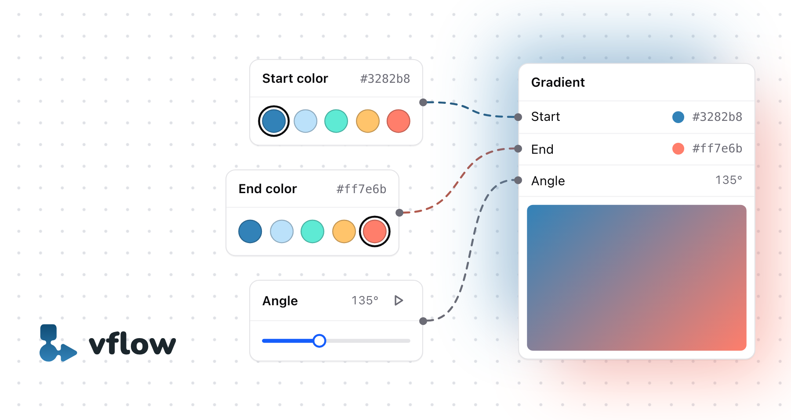

<div align="center">

[](https://www.npmjs.com/package/ngx-vflow)
[](https://www.npmjs.com/package/ngx-vflow)
[](https://github.com/artem-mangilev/ngx-vflow/blob/main/LICENSE)
[](https://discord.gg/RavS5ydTJV)

**ngx-vflow is an Angular library for building node-based editors and interactive diagrams.**

[Quickstart](https://www.ngx-vflow.org/docs/getting-started/quickstart) ·
[Docs](https://www.ngx-vflow.org/) ·
[Examples](https://www.ngx-vflow.org/examples/feature-overview) ·
[Discord](https://discord.gg/RavS5ydTJV)

</div>

## Features

- **Headless**: nodes, edges and handles are your own Angular templates and components
- **Connections**: drag from handle to handle, validate, reconnect
- **Editing**: drag, select, resize, snap, align, delete, keyboard shortcuts
- **Subflows**: nodes inside nodes
- **Viewport**: pan, zoom, fit, minimap, backgrounds, panels
- **Accessible**: nodes and edges are reachable from the keyboard and labeled for screen readers
- **Fast**: built on signals, with virtualization and lazy loading for large graphs

## Quickstart

```bash
npm i ngx-vflow
```

```ts
import { Component, signal } from '@angular/core';
import { Vui } from '@vflow/ui';
import { addEdges, Connection, createNodes, Edge, Vflow } from 'ngx-vflow';

@Component({
  selector: 'app-flow',
  imports: [Vflow, Vui],
  host: { class: 'block h-96' },
  template: `
    <vflow [nodes]="nodes" [edges]="edges()" (connect)="connect($event)">
      <div *vNode="let ctx of nodes" vuiNode class="px-4 py-2">
        <span vuiPort handleType="target" position="left"></span>
        {{ ctx.data().label }}
        <span vuiPort handleType="source" position="right"></span>
      </div>

      <svg:g *vEdge>
        <svg:path vuiEdge />
      </svg:g>
    </vflow>
  `,
})
export class FlowComponent {
  protected readonly nodes = createNodes([
    { id: 'fetch', point: { x: 40, y: 120 }, data: { label: 'Fetch orders' } },
    { id: 'remind', point: { x: 280, y: 120 }, data: { label: 'Send reminder' } },
  ]);

  protected readonly edges = signal<Edge[]>([]);

  protected connect(connection: Connection): void {
    const edge = { id: crypto.randomUUID(), ...connection };

    this.edges.update((edges) => addEdges([edge], { nodes: this.nodes, edges }));
  }
}
```

Two nodes you can drag and connect. The look comes from [`@vflow/ui`](https://www.ngx-vflow.org/packages/ui/overview),
optional Tailwind parts that `npx @vflow/cli ui` copies into your app; without it, style the same elements with your
own CSS, as the [quickstart](https://www.ngx-vflow.org/docs/getting-started/quickstart) does.

## Packages

| Package                                                            |                                                          |
| ------------------------------------------------------------------ | -------------------------------------------------------- |
| [`ngx-vflow`](https://www.ngx-vflow.org/)                          | The engine: canvas, nodes, edges, handles, interactions  |
| [`@vflow/ui`](https://www.ngx-vflow.org/packages/ui/overview)      | Styled parts copied into your app by `npx @vflow/cli ui` |
| [`@vflow/routing`](https://www.ngx-vflow.org/packages/routing)     | Edges that route around nodes                            |
| [`@vflow/layout`](https://www.ngx-vflow.org/packages/layout)       | Automatic layouts: dagre, ELK, d3-force                  |
| [`@vflow/auto-size`](https://www.ngx-vflow.org/packages/auto-size) | Parent nodes that grow around their children             |

## Compatibility

| ngx-vflow   | Angular   |
| ----------- | --------- |
| v3.x (next) | v20.0.0+  |
| v2.x        | v19.2.17+ |
| v1.x        | v17.3.12+ |
| v0.x        | v16.2.0+  |

## Community

Questions go to [Discord](https://discord.gg/RavS5ydTJV), bugs and ideas to
[GitHub Issues](https://github.com/artem-mangilev/ngx-vflow/issues). To work on the library itself, see
[CONTRIBUTING.md](https://github.com/artem-mangilev/ngx-vflow/blob/main/CONTRIBUTING.md).

## License

MIT © [Artem Mangilev](https://github.com/artem-mangilev)
